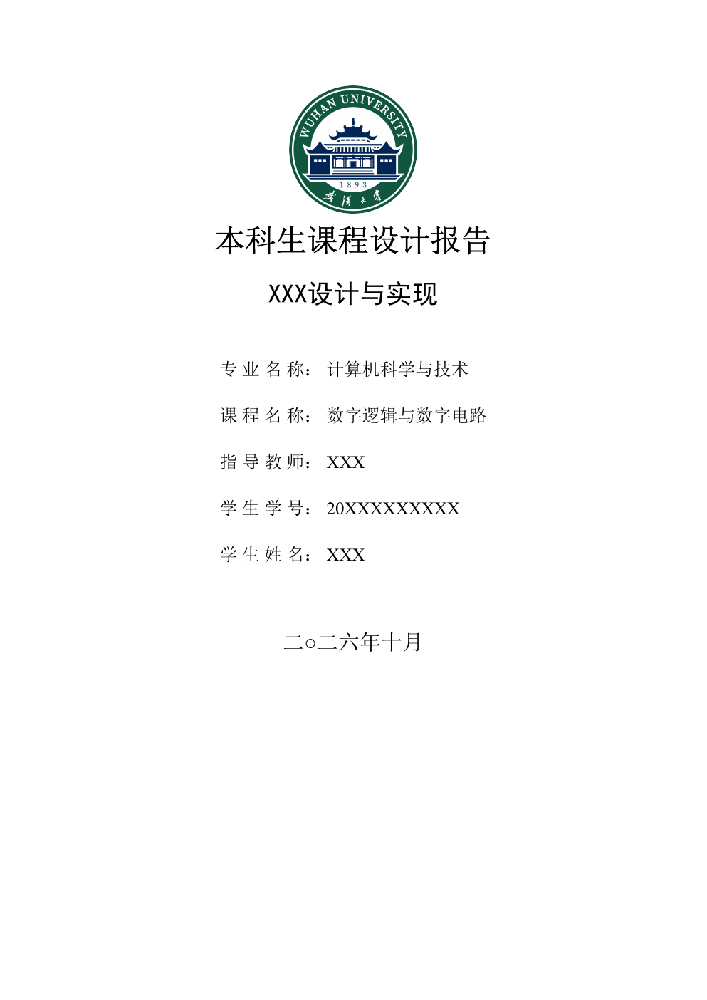
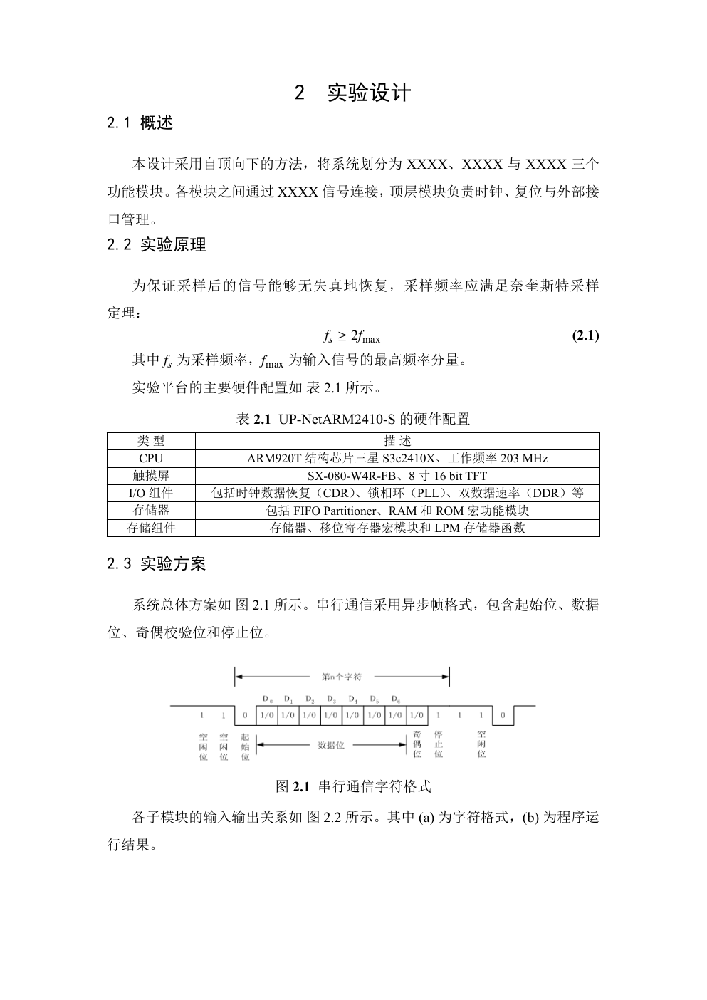
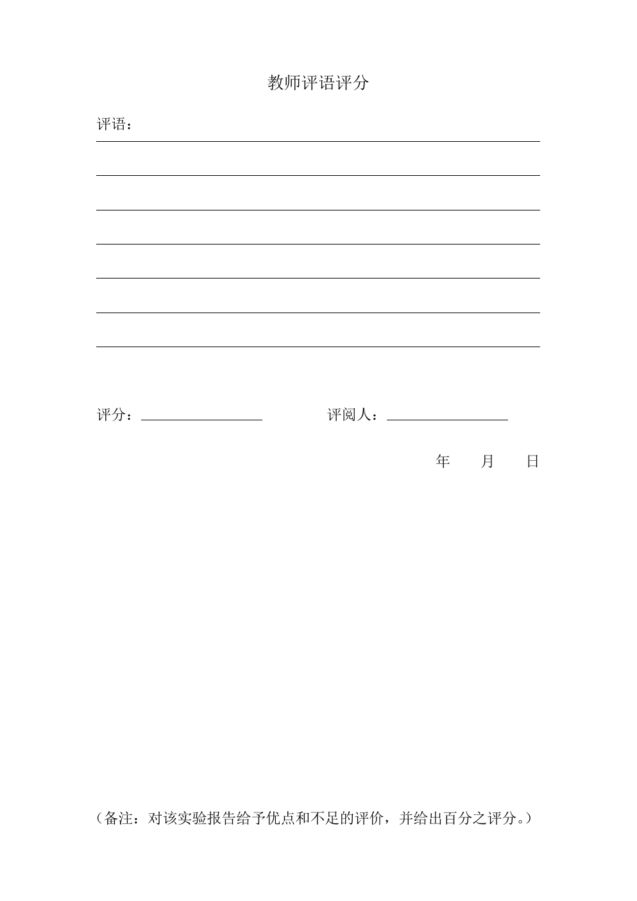

# 武汉大学计算机学院本科生课程设计报告的 Typst 主题


## 文件结构

```text
.
├── lib.typ                 # 主题实现（页面、字体、标题、图表、公式、目录、封面等）
├── main.typ                # 完整示例：封面 → 声明 → 摘要 → 目录 → 正文 → 评语页
├── refs.bib                # 示例参考文献
├── assets/                 # 示例图片与武汉大学校徽
├── main.pdf                # 示例编译结果（可直接查看效果）
├── preview/                # 封面、正文与评语页预览图
├── typst.toml              # Typst 包元数据
└── README.md
```

> 校徽 `assets/whu-emblem.png` 下载自 [武汉大学标识页](https://www.whu.edu.cn/xxgk/wdbs.htm) 的官方校徽素材包。
## 快速开始

```bash
typst compile main.typ
```

## 预览







默认字体：

- 中文正文：宋体（SimSun），回退 Noto Serif CJK SC
- 中文标题：黑体（SimHei），回退 Noto Sans CJK SC
- 西文/数字：Times New Roman
- 代码：DejaVu Sans Mono

如果系统缺少某个字体，Typst 会给出 `unknown font family` 警告并自动回退；也可以按下文“字体”一节覆盖。

## 最小示例

```typst
#import "lib.typ": *

#show: report.with()

#cover(
  title: "数字频率计的设计与实现",
  major: "计算机科学与技术",
  course: "数字逻辑与数字电路",
  supervisor: "张三",
  student-id: "2023302111001",
  student-name: "李四",
  date: (2025, 7),
)

#declaration()

#abstract(
  keywords: ("数字逻辑", "FPGA", "Verilog"),
)[
  这里是中文摘要。
]

#toc()

#main-matter[
  = 实验目的和意义

  == 实验目的

  正文段落，首行自动缩进两字符。

  === 目的一：检验 XXXX

  正文……

  $ y(t) = A sin(2 pi f t + phi_0) $ <eq-sine>

  由式 @eq-sine 可知……

  #figure(
    image("assets/serial-format.png", width: 78%),
    caption: [串行通信字符格式],
  ) <fig-serial>

  如图 @fig-serial 所示……

  = 实验设计

  == 概述

  正文……

  #references("refs.bib")
]

#review()
```

`#main-matter[...]` 是正文入口，负责：

1. 另起一页；
2. 把正文页码重置为 1；
3. 允许页脚显示页码（仅当 `report(page-numbering: "1")` 时）。

请只调用一次，并把所有正文章节放在其中。

## 封面接口

`#cover(...)` 的所有字段都是命名参数，默认值即占位符：

| 参数 | 默认值 | 说明 |
| --- | --- | --- |
| `college` | `"武汉大学计算机学院"` | 封面第一行，1 号宋体加粗居中 |
| `report-type` | `"本科生课程设计报告"` | 封面第二行，1 号宋体加粗居中 |
| `title` | `"XXX设计与实现"` | 报告题目，2 号黑体加粗居中 |
| `major` | `"XXX XXX"` | 专业名称 |
| `course` | `"XXX XXX"` | 课程名称 |
| `supervisor` | `"XXX"` | 指导教师 |
| `student-id` | `"20XXXXXXXXX"` | 学生学号 |
| `student-name` | `"XXX"` | 学生姓名 |
| `date` | `auto` | `auto`、`"二○二五年七月"`、`(2025, 7)`、`(year: 2025, month: 7)` 或 `none` |
| `logo` | `auto` | 默认读取 `assets/whu-emblem.png`；可传自己的 `image(...)`，或 `none` 关闭 |
| `logo-width` | `3.8cm` | 校徽宽度（方形校徽同时决定高度） |
| `show-college` | `false` | 是否在校徽下方显示“武汉大学计算机学院”；默认只显示校徽 |
| `extra` | `none` | 信息栏与日期之间的附加内容 |
| `labels` | 见下 | 五项字段的标签文字 |
| `fonts` | `whucs-fonts` | 字体配置 |
| `embolden` | `0.3pt` | 宋体伪粗描边宽度；有真粗体字体时可设为 `0pt` |
| `title-leading` | `16.8pt` | 题目行距（约 32 pt 基线） |
| `info-leading` | `28.6pt` | 信息栏行距（约 2.0 倍行距） |
| `date-size` | `18pt` | 日期字号 |

`labels` 默认：

```typst
(
  major: "专 业 名 称",
  course: "课 程 名 称",
  supervisor: "指 导 教 师",
  student-id: "学 生 学 号",
  student-name: "学 生 姓 名",
)
```

信息栏使用两列网格：标签右对齐、值左对齐，整个信息栏在页面水平居中。封面顶部默认只居中显示圆形校徽，不显示学院名称文字；需要时可用 `show-college: true` 恢复。

## 全局样式接口

```typst
#show: report.with(
  page-numbering: "1",   // 可选：页脚显示页码
)
```

| 参数 | 默认值 | 说明 |
| --- | --- | --- |
| `paper` | `"a4"` | 纸张 |
| `margin` | `(left: 3.175cm, right: 3.175cm, top: 2.54cm, bottom: 2.54cm)` | 页边距 |
| `header` | `none` | 页眉 |
| `page-numbering` | `none` | 默认不显示页脚页码，与模板一致；设为 `"1"` 显示 |
| `fonts` | `whucs-fonts` | 字体字典，支持只覆盖部分键 |
| `body-size` | `12pt` | 正文小四 |
| `body-leading` | `15.1pt` | 1.5 倍行距对应的额外行距（总基线约 23.4 pt） |
| `first-line-indent` | `21pt` | 首行缩进（模板实测值） |
| `par-spacing` | `auto` | 段间距；`auto` 等于 `body-leading`，使段间与行间一致 |
| `chapter-size` | `18pt` | 章标题小二号 |
| `section-size` | `14pt` | 节标题四号 |
| `subsection-size` | `12pt` | 小节标题小四 |
| `chapter-above` | `14.4pt` | 章标题段前 0.8 行 |
| `chapter-below` | `14pt` | 章标题段后（模板为 9pt，这里略增以与正文行距协调） |
| `section-above` | `12pt` | 节标题段前 |
| `section-below` | `26pt` | 节标题段后，大于正文行距 |
| `subsection-above` | `10pt` | 小节标题段前 |
| `subsection-below` | `26pt` | 小节标题段后，大于正文行距 |

> 不编号的一级标题（结论、参考文献、附录、致谢）后面直接接文字，段后统一为 26 pt；编号章标题后面通常是节标题，由节标题的段前距补足。
| `heading-pagebreak` | `true` | 一级标题前自动分页 |
| `caption-size` | `12pt` | 图表题注小四 |
| `table-size` | `10.5pt` | 表内容五号 |
| `table-inset` | `(x: 0.5em, y: 0.35em)` | 单元格内边距 |
| `figure-gap` | `0.6em` | 图表内容与题注间距 |

## 前置/后置页面

| 函数 | 说明 |
| --- | --- |
| `#declaration(...)` | 学术声明页；可传 `statement`、`signature`、`date` |
| `#abstract(keywords: (...))[...]` | 中文摘要；`keywords` 可为数组或内容 |
| `#abstract-en(keywords: (...))[...]` | 可选英文摘要 |
| `#toc(depth: 2)` | 目录；一级标题黑体四号，二级标题宋体小四 |
| `#main-matter[...]` | 正文入口，重置页码 |
| `#references("refs.bib")` | 参考文献页，默认 GB/T 7714—2015 顺序编码制 |
| `#appendix[...]` | 附录，不编号一级标题，自动进入目录 |
| `#acknowledgements[...]` | 致谢，不编号一级标题，自动进入目录 |
| `#review(...)` | 教师评语评分页 |

`#references(...)` 使用 `full: true` 列出 `.bib` 中的全部条目；如果只想列出被引用的条目，传 `full: false` 并在正文中使用 `@key` 引用。

### 参数速查

**`declaration`**

| 参数 | 默认值 | 说明 |
| --- | --- | --- |
| `title` | `[郑 重 声 明]` | 标题 |
| `statement` | 模板声明全文 | 声明正文 |
| `signature` | `none` | 签名；`none` 时留下划线 |
| `date` | `none` | 日期；`none` 时留下划线 |
| `fonts` | `whucs-fonts` | 字体 |
| `embolden` | `0.3pt` | 标题伪粗描边 |

**`abstract` / `abstract-en`**

| 参数 | 默认值 | 说明 |
| --- | --- | --- |
| `title` | `[摘　要]` / `[Abstract]` | 标题 |
| `keywords` | `()` | 关键词数组或内容；空数组不输出关键词行 |
| `keywords-label` | `[关键词：]` / `[Key words: ]` | 关键词前缀 |
| `fonts` | `whucs-fonts` | 字体 |
| `title-size` | `18pt` | 标题字号 |
| `indent` | `21pt` | 中文摘要首行缩进 |
| `leading` | `14.7pt` / `15.1pt` | 摘要行距参数 |

**`toc`**

| 参数 | 默认值 | 说明 |
| --- | --- | --- |
| `title` | `[目　录]` | 标题 |
| `depth` | `2` | 收录层级 |
| `indent` | `0pt` | 缩进；可传长度或 `level => ...` 函数 |
| `fonts` | `whucs-fonts` | 字体 |
| `title-size` | `18pt` | 标题字号 |
| `leading-1` | `17.6pt` | 一级条目行距 |
| `leading-2` | `15.1pt` | 二级条目行距 |

**`references`**

| 参数 | 默认值 | 说明 |
| --- | --- | --- |
| `sources` | 必填 | `.bib` 路径或文献数据 |
| `title` | `[参考文献]` | 标题 |
| `style` | `"gb-7714-2015-numeric"` | CSL 样式 |
| `full` | `true` | 是否列出全部条目 |
| `fonts` | `whucs-fonts` | 字体 |

**`review`**

| 参数 | 默认值 | 说明 |
| --- | --- | --- |
| `title` | `[教师评语评分]` | 标题 |
| `lines` | `7` | 评语横线数量 |
| `line-gap` | `32pt` | 评语横线之间的垂直间距 |
| `comment` | `none` | 预填评语 |
| `score` | `none` | 评分；`none` 时留下划线 |
| `reviewer` | `none` | 评阅人；`none` 时留下划线 |
| `date` | `none` | 日期 |
| `note` | 模板备注全文 | 底部备注 |
| `note-size` | `14pt` | 备注字号 |
| `note-tracking` | `-0.2pt` | 备注字距微调（保证单行） |
| `fonts` | `whucs-fonts` | 字体 |

## 图表与公式

### 图

```typst
#figure(
  image("assets/serial-format.png", width: 78%),
  caption: [串行通信字符格式],
) <fig-serial>

如图 @fig-serial 所示。
```

- 图题在图下方，宋体小四，编号加粗，按章编号（图 1.1、图 2.1……）。
- 交叉引用 `@fig-serial` 自动显示“图 1.1”，不要写成“图 @fig-serial”。

### 表

全线表：

```typst
#figure(
  grid-table(
    columns: (18%, 82%),
    [类 型], [描 述],
    [CPU], [ARM920T ……],
  ),
  kind: table,
  caption: [UP-NetARM2410-S 的硬件配置],
) <tbl-hardware>
```

三线表：

```typst
#figure(
  three-line-table(
    rows: 9,            // 包含表头在内的总行数，必须写成命名参数
    columns: 4,
    [实验组], [采样次数], [统计值], [误差],
    [第 1 组], [100], [210], [4.27%],
    // ……
    [合计], [700], [1522], [7.16%],
  ),
  kind: table,
  caption: [A/D 转换结果分析],
) <tbl-ad>
```

- 表题在表上方，黑体小四，编号为 Times New Roman 粗体。
- 表内容宋体/Times New Roman 五号（10.5 pt），行距固定 15 pt。
- 三线表为 1.5 pt 顶线/底线 + 0.5 pt 表头线。
- 交叉引用 `@tbl-ad` 自动显示“表 2.1”。

### 子图

```typst
#figure(
  grid(
    columns: (1fr, 1fr),
    gutter: 1.2em,
    align: bottom,
    subfigure(image("a.png", width: 100%), caption: [(a) 子图 A]),
    subfigure(image("b.png", width: 100%), caption: [(b) 子图 B]),
  ),
  caption: [总图题],
) <fig-sub>
```

`subfigure` 只生成 `(a)` 这类子标题，不单独编号。

### 公式

```typst
$ f_s >= 2 f_(max) $ <eq-sample>

由式 @eq-sample 可知……
```

- 公式居中，编号右对齐，按章编号：`(1.1)`、`(2.1)`……
- 编号使用 Times New Roman 粗体。
- 公式前后请留空行，以按行间公式排版；行内公式直接写在段落中即可。

## 目录与页码

- 目录默认收录一级、二级标题（`depth: 2`），一级为黑体四号，二级为宋体小四，均 1.5 倍行距。
- 目录不缩进，与模板一致；如需缩进，可传 `#toc(indent: level => (level - 1) * 2em)`。
- 默认 `page-numbering: none`，页脚不显示页码，与模板一致；目录中仍显示正文页码（`main-matter` 把正文第一页重置为 1）。
- 如需页脚页码：

```typst
#show: report.with(page-numbering: "1")
```

封面、声明、摘要、目录页不显示页脚页码；`main-matter` 之后开始显示。

## 与 Word 模板的对应关系

| 项目 | 模板要求 | 本主题 |
| --- | --- | --- |
| 纸张 | A4 | A4 |
| 页边距 | 左右 3.175 cm，上下 2.54 cm | 相同 |
| 正文 | 宋体小四（12 pt），1.5 倍行距，首行缩进 2 字符 | 12 pt，约 23.4 pt 行距，21 pt 缩进 |
| 章标题 | 黑体小二号（18 pt）加粗居中，段前 0.8 行、段后 0.5 行 | 字号/对齐相同；段后增至 14 pt，便于与正文拉开距离 |
| 节标题 | 黑体四号（14 pt）加粗 | 相同 |
| 小节标题 | 黑体小四（12 pt）加粗 | 相同 |
| 摘要 | 标题黑体小二号；正文宋体小四，固定 23 pt 行距；关键词黑体小四 | 相同 |
| 目录 | 标题黑体小二号；章条目黑体四号，其余宋体小四，1.5 倍行距 | 相同 |
| 图题 | 宋体小四，编号加粗，图下方 | 相同，按章编号 |
| 表题 | 黑体小四，数字/字母 Times New Roman 粗体，表上方 | 相同，按章编号 |
| 表内容 | 宋体或 Times New Roman 五号 | 10.5 pt |
| 公式 | 居中，编号右对齐，按章编号 | 相同，编号加粗 |
| 参考文献 | 标题黑体小二号；条目宋体小四，1.5 倍行距 | 相同，GB/T 7714 顺序编码制 |
| 封面 | 1 号宋体校名/报告类型；2 号黑体题目；小 3 信息；18 pt 日期 | 相同，全部字段可传参 |
| 学术声明 | 宋体粗体 2 号标题；4 号正文，固定 23 pt 行距 | 相同 |
| 教师评语页 | 宋体 3 号标题；4 号评语/评分 | 相同 |

## 字体

默认字体配置为：

```typst
#let whucs-fonts = (
  body: ("Times New Roman", "SimSun", "Noto Serif CJK SC"),
  sans: ("SimHei", "Noto Sans CJK SC"),
  caption-sans: ("Times New Roman", "SimHei", "Noto Sans CJK SC"),
  mono: ("DejaVu Sans Mono", "Noto Sans Mono"),
)
```

覆盖部分字体：

```typst
#let my-fonts = (
  body: ("Times New Roman", "Songti SC"),
  sans: ("Heiti SC",),
)

#show: report.with(fonts: my-fonts)

// 组件函数各自也接受 fonts 参数；如果覆盖了字体，请一并传入
#cover(fonts: my-fonts)
#declaration(fonts: my-fonts)
#abstract(fonts: my-fonts, keywords: (...))[……]
#toc(fonts: my-fonts)
```

宋体/黑体通常只有 Regular 字重。封面和声明标题的“粗体”通过 `stroke` 描边模拟 Word 的伪粗；如果所用字体自带粗体（如 Noto Serif CJK SC Bold），可把 `cover(embolden: 0pt)`、`declaration(embolden: 0pt)` 设为 0。
